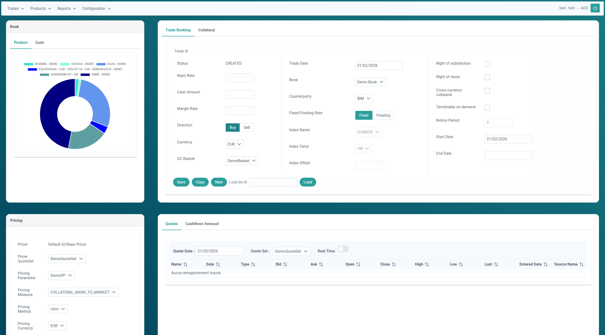

# Eclipse Tradista – Local Demo Environment

&emsp;&emsp;

Welcome to the official Eclipse Tradista demo package. This self-contained environment allows you to deploy and explore Eclipse Tradista locally on **Windows** and **Linux/Unix** in just a few clicks.

This pre-configured package includes:
* **Eclipse Tradista Database** (Pre-loaded with sample data)
* **Tradista Application Server**
* **Desktop Client & Web Dashboards**

---

## 🚀 Quick Start Guide

Follow these steps in order to spin up your local environment:

### 1. Launch the Stack
Execute the following scripts from your installation directory depending on your OS:

| Step | Component | Windows Script | Linux/Unix Script |
| :--- | :--- | :--- | :--- |
| **1** | 🗄️ **Database** | `startTradistaDB.bat` | `./startTradistaDB.sh` |
| **2** | ⚙️ **Server** | `startTradistaServer.bat` | `./startTradistaServer.sh` |
| **3** | 💻 **Desktop Client** | `startTradistaClient.bat` | `./startTradistaClient.sh` |

### 2. Access the Web Dashboards
Open your browser and navigate to the specialized modules:

* **Repo Trading (GC & Specific):** [http://localhost:8080/web/login.xhtml](http://localhost:8080/web/login.xhtml)
* **Equity Trading Demo:** [http://localhost:8080/web/loginDemo.xhtml](http://localhost:8080/web/loginDemo.xhtml)

📌 **Credentials:** Use `test` / `test` for both Username and Password.

#### 🖥️ Preview: Repo Trading Dashboard

---

## 📊 What's Inside? (Sample Data)

To help you evaluate the platform right away, this environment comes pre-loaded with a comprehensive set of dummy market data. All trades across multiple asset classes are pre-booked under the **'Demo Book'** book.

---

## 🤝 Contribution & Feedback

We are constantly improving Eclipse Tradista. Your feedback is highly valuable to us:

* **Found a bug or want a new core feature?** Open an issue on the main [Eclipse Tradista Repository](https://github.com/eclipse/tradista).
* **Need more specific sample data for this demo?** Feel free to request it directly here on the [Eclipse Tradista Demo Repository](https://github.com/eclipse/tradista-demo).

---

<i>This demo environment is proudly packaged using Install4J.</i>

